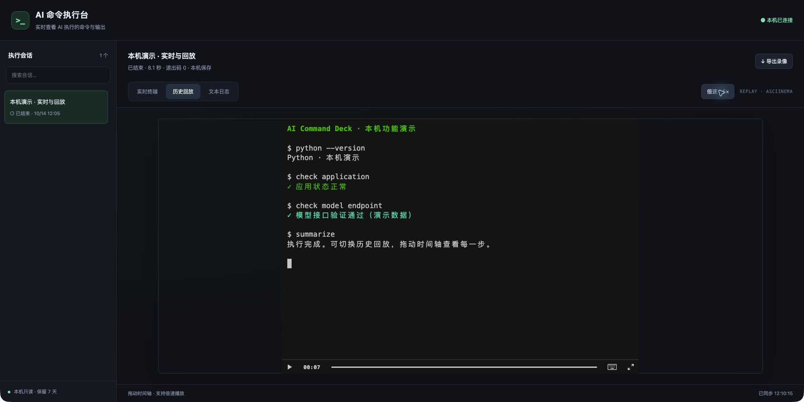

# AI Command Deck · AI 命令执行台

在浏览器中实时观看 AI 执行终端命令，结束后按时间轴回放。适用于本机命令、SSH 运维，以及需要让执行过程可见的 AI agent 工作流。

- **命令与状态**：启动前展示实际命令，实时显示输出，结束后显示退出码和耗时；skill 中的 `deck_step` 逐步展示同一 SSH 会话里的操作。
- **实时终端**：接入 asciinema 官方播放器，通过本机 WebSocket 显示颜色、中文、光标移动与终端尺寸变化。
- **历史回放**：暂停、拖动时间轴、倍速播放，导出标准 `.cast` 录像。
- **无空行显示**：实时终端、历史回放与文本日志默认隐藏普通输出中的空行，旧录像同样生效；原始录像与导出文件保留原样。光标定位的全屏程序保留原始布局。
- **文本日志**：复制输出、自动换行、跟随最新；向上滚动暂停跟随，切换会话保留阅读位置。
- **会话管理**：搜索与切换会话，显示运行状态、耗时和退出码。
- **7 天保留期**：结束后计时；启动时和每小时清理过期日志、录像与元数据，运行中会话保留。
- **本机只读**：仅监听 `127.0.0.1`，网页没有命令执行接口；播放器资源本地打包，无 CDN 请求。
- **Codex skill**：可安装自动打开查看器的 SSH 工作流。



## 快速开始

要求 Python 3.10+，支持 macOS / Linux。原生 Windows PTY 暂不支持，可在 WSL 使用。

```bash
python3 -m venv .venv
source .venv/bin/activate
python -m pip install .
ai-command-deck serve --port 8768
```

在 Chrome 打开 <http://127.0.0.1:8768/>，在另一个终端启动要观察的命令：

```bash
ai-command-deck run --name 'SSH · 开发服务器' -- ssh user@server.example.com
```

也可以运行本机程序：

```bash
ai-command-deck run --name '本机演示' -- python -u examples/demo.py
```

命令始终在启动它的终端中交互；浏览器只负责观看。SSH 认证和主机密钥检查由 SSH 正常处理。

## 录像和 asciinema

本项目使用 **asciinema 官方 Web 播放器 3.17.0**，配套 Python PTY 记录器写入 **asciicast v2**，本机服务器提供 **ALiS v1** 实时流。无需安装 asciinema CLI，也不会自动上传到 asciinema.org。

录像保留输出时间与窗口缩放事件，可以用 asciinema CLI 播放：

```bash
asciinema play /path/to/session.cast
```

每个会话对应 `.json` 元数据、原始 `.log` 输出和 `.cast` 录像。旧版查看器的 `.json` / `.log` 记录仍可在文本模式中查看，旧日志没有时间信息，不能追溯生成真实回放。

实时模式会在连接或重连时快进已有录像恢复完整终端状态；长会话可能需要较长初始化时间。文本视图每次只显示最近 500 KB，完整录像按磁盘容量保存。实时终端显示的是终端屏幕，完整滚动日志请使用文本视图。

## 数据与保留期

默认存放在 `~/.codex/terminal-viewer/sessions`，目录权限 `0700`，会话文件权限 `0600`。可通过环境变量指定路径与保留期，服务器和记录器应使用相同配置：

```bash
export TERMINAL_VIEWER_DATA=/path/to/private/sessions
export TERMINAL_VIEWER_RETENTION_DAYS=7
```

也可使用全局参数：

```bash
ai-command-deck --retention-days 7 --data-dir /path/to/private/sessions serve
ai-command-deck --retention-days 7 --data-dir /path/to/private/sessions run -- ssh user@server.example.com
ai-command-deck cleanup
```

清理在服务器/记录器启动时及服务器运行期间每小时执行。服务器停止时不会后台清理，下次启动时补做。异常退出的会话按文件最后修改时间计算。导出到其他目录的录像不在自动清理范围内。

记录器不记录原始键盘输入，关闭回显的密码输入不会被记录。启动命令、每步命令和输出中的敏感内容仍可能出现在本机日志中，请勿把真实日志和录像提交到代码仓库。本项目不是生产堡垒机，不提供用户鉴权和防篡改审计。

## 安装 Codex skill

先按快速开始将项目安装到一个长期保留的虚拟环境，再运行：

```bash
python scripts/install_skill.py
```

安装到 `$CODEX_HOME/skills/server-terminal-viewer`（未设置时为 `~/.codex/skills/server-terminal-viewer`）。已有 skill 会先备份。安装器记录当前 Python 路径，请保留该虚拟环境；移动环境后重新安装 skill。

skill 提示 agent 在执行用户授权的服务器命令前打开外置 Chrome，并通过记录器执行。skill 自动匹配属于 agent 的行为，无法保证每个聊天都强制触发；需要时可明确输入 `$server-terminal-viewer`。

## 开发与验证

```bash
python -m pip install -e .
python -m unittest discover -s tests -v
```

测试覆盖真实 PTY 的退出码、中文和分段 UTF-8、无回显输入不入录像、保留期、HTTP 只读边界、WebSocket 连接/重连与录制结束。

## 目录

```text
ai_command_deck/     本机服务、PTY 记录器、存储、前端及官方播放器
skill/              可复用的 Codex skill
scripts/            skill 安装器和前端依赖更新器
examples/           不含服务器信息的本机演示
tests/             自动化验证
```

## 致谢与许可

本项目自有代码采用 MIT 许可。随项目分发的 [asciinema-player](https://github.com/asciinema/asciinema-player) 采用 Apache-2.0 许可，完整许可保留在 `ai_command_deck/static/vendor/LICENSE`。更多信息见 [THIRD_PARTY_NOTICES.md](THIRD_PARTY_NOTICES.md)。
